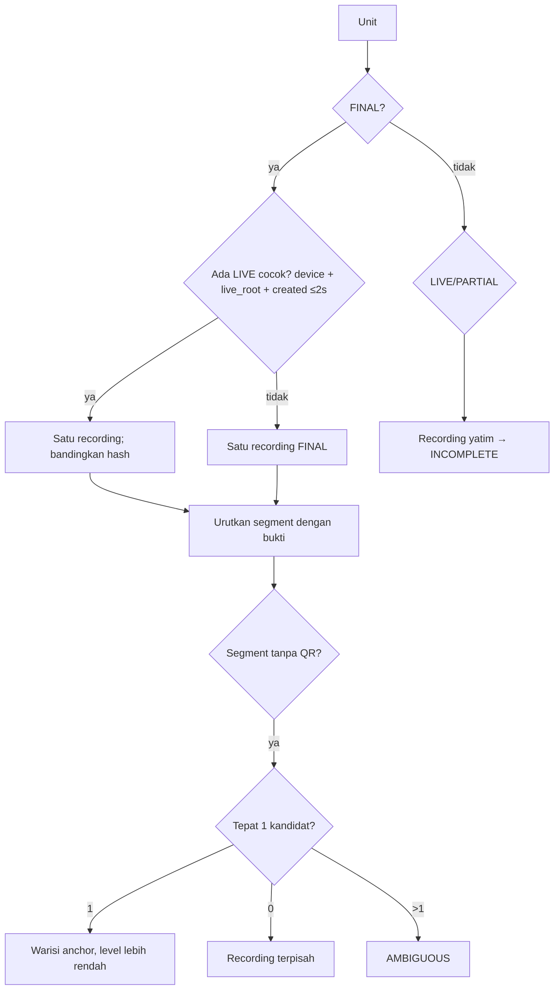

# ZYB Tool — Architecture

Status: **M1/M2 pipeline dan workspace desktop aktif; M3 local output foundation aktif dengan manifest unsigned** · 2026-11-25. Legenda: **[F]** fakta terverifikasi · **[A]** asumsi · **[?]** belum terverifikasi.
Pasangan dokumen: `PRD.md` (kebutuhan, status, aturan bisnis), `AGENTS.md`. Produk QR: `AITQR/ARCHITECTURE.md`.

## 1. Arsitektur yang direkomendasikan

**Desktop verifier offline (Python) di PC administrator**, dengan CLI dan UI desktop bertahap. Sistem keseluruhan adalah hybrid dua produk: AITQR (web/PWA, HP petugas) menerbitkan QR dan mengonfigurasi field payload; ZYB Tool (desktop) memverifikasi, mengelompokkan, menyiapkan output lokal, dan melaporkan. ZYBTool tidak terhubung ke OSS.

Dasar teknis:
- Workstation admin memiliki Python, `av` (PyAV), `cv2`, `numpy`; `cryptography` **belum** terpasang [F]. Metaqr (decoder Python) dan ZYWtool juga Python [F].
- Video 4+ GB (sampel 2: a multi-gigabyte media file [F]) harus diproses streaming dan lokal; tidak cocok dipindah ke browser.
- Kunci privat decoder hanya boleh di PC admin (aturan pemilik).
- Perangkat kamera tidak punya protokol/API yang terbukti [?]; tidak dieksplorasi pada tahap ini.

## 2. Hasil inspeksi yang menjadi dasar keputusan

### 2.1 Public fixture structure

The public fixtures demonstrate a flat finalized recording, a finalized primary recording
folder, and hidden live directories. All fixture identities, dates, clock values, camera
labels, and media measurements are synthetic.

### 2.2 Metadata contract

The parser consumes session JSON, synchronization JSON, a time-zero sidecar, camera
metadata, application logs, and optional frame-timing CSV files. Missing or conflicting
evidence lowers the result status; it is never resolved by guessing.

### 2.3 Evidence quality

- Container timeline is the primary source for video duration when media is available.
- Monotonic frame-timing values and session/synchronization claims are cross-checks.
- Application logs provide start, stop, and restart evidence.
- Camera sidecars provide crop geometry and capture-format metadata.
- Public fixtures use small synthetic values and deliberately omit video media.
### 2.4 Referensi pola nama folder (tanpa koneksi OSS)

oss://<bucket>/<approved-prefix>/
└── <project>/<site>/<date>/<operation>/
    ├── session metadata
    └── recording folders and media files

Nama folder yang pernah diamati pada OSS hanya menjadi referensi pola. ZYBTool tidak menyimpan kredensial OSS dan tidak melakukan listing/upload/download. session.json kamera tetap menjadi dokumen utama; payload QR yang lolos verifikasi hanya ditambahkan sebagai metadata pelengkap di namespace zybtool.qr_metadata pada folder output setelah Arrange MOVE. Field native tidak ditimpa. Scan tetap read-only.
## 3. Modul dan tanggung jawab

Paket `zybtool`; semua modul inti **fungsi murni atas dataclass** (I/O dipisah) agar dapat diuji sendiri.

| Modul | Tanggung jawab | Bergantung pada |
|---|---|---|
| `discovery` | Cari kandidat folder rekursif (termasuk berawalan titik), klasifikasi `FINAL` / `LIVE` / `PARTIAL`; tidak mengikuti symlink. | — |
| `meta` | Parse JSON/log/CSV menjadi `SessionFacts`; toleran, mencatat field/file hilang. | — |
| `videoscan` | Demux timeline (PyAV), keyframe, ukuran; rentang CSV; pengambil sampel frame untuk QR (crop mata). | `meta` |
| `qrverify` | Pembungkus Metaqr: deteksi token MQ1, dekripsi dengan private key X25519, validasi skema payload dan kecocokan device ID. Tidak ada signature/allow-list/replay. | Metaqr |
| `correlate` | Cek QR ↔ session/kamera/waktu. | `meta`, `qrverify` |
| `grouper` | Segment → recording → kamera; urutan; `AMBIGUOUS`. | `meta`, `videoscan` |
| `integrity` | SHA-256 streaming, manifest, tanda tangan/verifikasi manifest. | — |
| `status` | Fungsi keputusan: bukti → status + alasan + level. | semua bukti |
| `report` | JSON kanonik; render HTML/CSV. | `status` |
| `naming` | Scanner JSON read-only, nested field mapping, template render, No Shift dan preview. | `session.json`, payload QR terverifikasi |
| `output` | Plan lokal dan naming; `naming` merender template dari field JSON native dan payload QR terverifikasi; `operations` menjalankan MOVE dengan konfirmasi, hash, journal/Undo, dan Excel. | `report`, `integrity`, `naming` |
| `cli` | Orkestrasi dan antarmuka. | semua |

## 4. Aliran data

Setiap tahap menulis artefak JSON di `zyb_work/<run_id>/` (atomik: `.tmp` lalu rename); tahap berikutnya hanya membaca artefak. Rerun deterministik dan dapat diulang per tahap.

`inventory.json` → `groups.json` → `verification.json` → `manifest.json` + `manifest.sig` → `report.json` → `output_plan.json`.

Output preparation is local-only: operator previews a plan and confirms MOVE. Recording folders retain their names and hierarchy; hashes are checked and a journal enables guarded Undo. There is no OSS transfer stage.

## 5. Model data (ringkas)

| Entitas | Field kunci |
|---|---|
| `Unit` | path, kind (`FINAL`/`LIVE`/`PARTIAL`), `name_parts`, `facts`, file hilang |
| `Segment` | path mkv, ukuran, sha256, `packets`, `pts_first/last`, `csv_mono_first/last`, `restart_before` |
| `Recording` | `recording_id`, `unit_refs`, `device_id`, `segments[]` (urut), `cameras[]`, `duration_actual_s`, `anchors[]`, `status`, `reasons[]`, `level` |
| `QRObservation` | segment, frame, eye, waktu frame (wall), token hash, hasil dekripsi dan validasi payload |
| `Finding` | `code` (status PRD §7), `severity`, `subject`, `evidence[]`, `message` |
| `Manifest` | run_id, versi alat, daftar file (path relatif, ukuran, sha256), hasil per recording, waktu, tanda tangan admin |

`recording_id` = SHA-256 dari `device_id` + `object_id` + `capture_t0.t_wall_s` [A: `object_id` unik per recording; sampel 1 dan 2 berbeda].

Contoh `Finding`: `{"code":"INCOMPLETE","subject":".live_20250210_174436","severity":"error","evidence":["no session_sync.json","no t0.json","app.log tanpa baris stop"],"message":"Folder live tidak terfinalisasi"}`.

## 6. Integrasi QR

**Sumber QR:** AITQR (profil `zyb-recording`). Kontrak: skema payload dimiliki ZYB Tool; vektor uji bersama diuji di kedua repo.

**Pemindaian:** hanya video/segmen awal recording, mulai dari `usable_start_s` (lewati frame beku), jendela default 5 s, 5 fps (maksimal 25 frame sampel), **crop mata dari `meta.json`** (tanpa band IMU, tanpa pengecilan ke 1600 px seperti `scan_video` Metaqr) [A: jendela 5 detik perlu dikonfirmasi pada kamera nyata]. Segmen berikutnya tidak dipindai untuk mencari QR pengganti; tidak ada QR → `QR_MISSING`. Pembatasan ini mengurangi jumlah maksimum frame QR yang diuji 83,3% dibanding satu jendela 30 detik, dan mencegah pengulangan scan QR di setiap segmen. Demux/timeline integrity scan atas seluruh MKV tetap berjalan.

**Dekripsi MQ1:** Metaqr membuka token dengan private key X25519 decoder. Token yang tidak dapat didekripsi menghasilkan `QR_DECRYPT_FAILED`; token berhasil didekripsi dan lolos skema/device ID menghasilkan `QR_DECRYPTED`. Tidak ada signature, allow-list, atau replay detection.

**Korelasi (semua harus lolos untuk Level ≥3):**

| Cek | Aturan |
|---|---|
| C1 | `device_id` di QR = `session.json.device_id` dan identitas kamera. |
| C2 | Tanggal QR = `capture_date`. |
| C3 | `iat` QR ≤ waktu frame QR pertama (`segment_start_wall` + t frame) dan dalam toleransi konfigurabel dari `created` [A]. |
| C4 | Session ID QR dicatat sebagai metadata; tidak ada replay protection kriptografis pada MQ1. |
| C5 | QR muncul di awal recording (segment pertama, jendela awal); muncul hanya di tengah/akhir → warning. |
| C6 | Payload lolos skema `zyb-recording/v1`. |

**Pemetaan keterbatasan Metaqr:**

| Keterbatasan | Penanganan di ZYB Tool |
|---|---|
| Replay | Tidak ada replay detection; QR yang disalin tetap dapat didekripsi. |
| Identitas device | MQ1 tidak memiliki signer `kid`; device ID di payload dibandingkan dengan `session.json.device_id`. |
| QR↔video | Korelasi C1–C5 + hash file + manifest (Level 4). |
| Browser | Tanggung jawab AITQR. |
| Penyimpanan kunci | Private key decoder terlindungi Windows DPAPI; export plaintext hanya melalui aksi eksplisit dan perlu backup aman. |

## 7. Verifikasi video dan metadata

Per segment, `videoscan` menghasilkan bukti; `status` yang menafsirkan (aturan keputusan ada di sana, bukan di scanner).

| Pemeriksaan | Cara | Hasil buruk |
|---|---|---|
| Dapat dibuka/demux | PyAV; paket PTS monoton | `CORRUPTED` |
| Durasi aktual | `pts_last − pts_first` + 1 interval frame dari timeline mkv | dasar semua perbandingan |
| Klaim vs aktual | selisih ke tiap klaim (§2.3) ≤ `max_duration_skew_s` (2,0 s [F gerbang perangkat]) | `METADATA_MISMATCH` |
| Silang CSV | rentang `mono_us` vs durasi aktual ≤ 3,0 s [A] | warning, lalu mismatch jika jauh |
| Kelengkapan | file wajib FINAL: `session.json`, `session_sync.json`, `t0.json`, `stereo/meta.json`, mkv, CSV IMU | `INCOMPLETE` |
| `session_sync.ok`/`fails` | `ok:false` atau `fails` tak kosong | warning/`INCOMPLETE` |
| Sidecar CSV | `frame_idx` maks ≈ `last_sidecar_frame`; baris ±2/3 frame itu normal [F] | tidak dipakai menghitung durasi |
| Jejak encoder | codec/encoder berbeda dari `hardware-encoder` | warning heuristik (bukan bukti) [?] |
| Pemotongan awal | QR tidak ada di segment pertama padahal ada di lain | `QR_MISSING`/mismatch |
| Mode dalam: dekode penuh | opsional, per permintaan | `CORRUPTED` bila gagal |

Mode cepat (default): demux tanpa dekode + sampel frame QR. Mode dalam: dekode seluruh frame untuk mendeteksi korupsi tengah file.

## 8. Algoritma pengelompokan segment

Prinsip: bukti temporal dan relasi metadata, bukan nama file. Tidak menebak.

**Langkah**
1. **Klasifikasi unit** dari `discovery`: `FINAL` (punya `session.json`, `session_sync.json`, `t0.json`, `stereo/meta.json`), `LIVE` (nama `.live_<YYYYMMDD>_<HHMMSS>` atau belum terfinalisasi), `PARTIAL` (sisanya yang berisi mkv). Folder datar (sampel 1) = `FINAL` tanpa nama primary.
2. **Identitas unit:** `(device_id, live_root, capture_t0.t_wall_s, object_id)`. Untuk `LIVE`, `live_root` = nama folder.
3. **Tautkan FINAL ↔ LIVE:** syarat keras semua terpenuhi: `device_id` sama, `live_root` FINAL = nama folder LIVE, `|created − created_live| ≤ 2 s`. Tertaut → satu recording; bandingkan ukuran/hash mkv (sama = salinan; beda = `AMBIGUOUS`). Tak ada tautan → LIVE berdiri sendiri (yatim) → `INCOMPLETE`. Sampel 2: dua LIVE (device `…0260`) tidak punya FINAL dan device-nya berbeda dari FINAL `…81e2` → tidak digabung.
4. **Segment dalam satu unit:** mkv per direktori kamera. Urutan dari bukti, prioritas: (a) rentang `mono_us` CSV (monoton, valid dalam satu boot); pada folder `.live_*` CSV bersifat **tingkat run** (`stereo_run_imu_frametimes.csv`, satu file untuk semua mkv [F]), pemetaan per segment [?] belum diverifikasi, (b) `segment_start_wall`/`app.log` (`RESTART`, `segment_start_number`), (c) PTS container, (d) indeks nama file sebagai petunjuk saja. Bukti saling bertentangan → `AMBIGUOUS`.
5. **Kontinuitas:** jeda antar segment dari bukti (a)/(b); jeda ≤ ambang (default 5 s [A]) = bersambung; lebih besar atau tumpang tindih = warning/`INCOMPLETE`; catat `restart_before`.
6. **Lintas unit (segment tanpa QR di unit lain):** digabung **hanya jika** tepat satu kandidat memenuhi: `device_id` sama, `live_root` atau `capture_t0` sama (atau kontinuitas monoton dalam satu boot), interval tidak tumpang tindih. Nol kandidat → recording terpisah. Lebih dari satu → `AMBIGUOUS`. Kedekatan waktu saja tidak pernah cukup.
7. **Anchor QR:** QR terverifikasi dan terkorelasi pada satu segment menjadi anchor untuk recording itu; segment lain di recording yang sama mewarisi dengan level lebih rendah bila korelasi metadata lolos; tanpa anchor sama sekali → `METADATA_ONLY`.
8. **Multi-kamera:** setiap subfolder yang punya `meta.json` dan mkv diperlakukan sebagai kamera; `wrists/gloves/bands` di `session_sync.json` dipakai bila terisi. Format selain `stereo` [?] belum pernah diamati.
9. **Keluaran stabil:** recording diurutkan `(device_id, created)`, segment menurut bukti; tidak bergantung pada urutan filesystem.

## 9. Output structure and naming reference

The original recording_primary_* folder and its contents are never renamed. Any
operational wrapper is a new parent folder.

    ZYB_Output/<OPERATION_NAME>/recording_primary_<original-name>/

The native session.json is authoritative. Successfully decrypted MQ1 payload is added as a supplemental zybtool.qr_metadata object after MOVE; native fields are not replaced. Recordings without a decrypted QR remain under _UNNAMED. Destination conflicts stop
the operation; automatic suffixes and overwrites are forbidden.

Pola folder OSS hanya menjadi referensi. QR bukan pengganti session.json: ZYBTool menyimpan payload MQ1 yang sudah didekripsi sebagai session.json.zybtool.qr_metadata pada output MOVE, menjaga semua properti native. Jika struktur zybtool atau qr_metadata sudah berisi data yang tidak boleh ditimpa, proses berhenti aman. Hash manifest mencatat hash sumber dan hash file hasil enrichment.

Folder naming dikendalikan oleh Preferences lokal: JSON scanner membaca `session.json` kamera atau JSON contoh payload QR secara read-only dan mendeteksi nested object/array; mapping token disimpan di profil Windows. Saat Arrange, path mapping dibaca ulang dari session.json native atau payload QR yang telah lolos verifikasi. Template hanya mengubah nama folder induk baru. No Shift menghilangkan token SESSION dari hasil, tanpa mengubah skema QR AITQR.
## 10. Tingkat kepercayaan dan threat model

| Level | Bukti | Membuktikan | **Tidak** membuktikan |
|---|---|---|---|
| 0 | Metadata saja | Berkas konsisten secara internal | Asal recording atau payload QR |
| 1 | QR MQ1 berhasil didekripsi + skema dan device ID cocok | Payload rahasia dapat dibaca oleh pemegang private key decoder dan konsisten dengan session | Identitas pembuat QR, identitas petugas, keaslian video, atau anti-replay |
| 2+ | Belum diimplementasikan | Tidak ada klaim autentikasi tambahan | Tidak boleh ditampilkan sebagai VERIFIED |

MQ1 memberi kerahasiaan, bukan autentikasi. Siapa pun yang mengetahui public key decoder dapat membuat QR terenkripsi yang dapat didekripsi oleh ZYBTool.
| Ancaman | Mitigasi | Risiko sisa |
|---|---|---|
| QR screenshot/diputar ulang | Replay tingkat recording, C3–C5 (waktu dan posisi QR) | Replay pada recording baru oleh pemegang HP yang sah |
| Pemalsuan JSON metadata | Durasi/waktu dibandingkan dengan timeline mkv + hash | Pemalsu konsisten atas seluruh berkas dan video |
| Manipulasi timestamp | Wall vs monotonic, bukti ganda, `iat` vs frame QR | Jam kamera/HP dapat diubah [?] sumber waktu box belum diperiksa |
| Video diedit/dipotong | Hash + manifest; QR di awal; durasi vs klaim; jejak encoder | Re-encode lengkap + edit seluruh metadata |
| Durasi dipalsukan | Timeline mkv sebagai dasar | Seperti di atas |
| Pemalsuan metadata QR | Payload hanya dipakai setelah dekripsi dan korelasi device ID | Siapa pun yang memiliki public key decoder dapat membuat token |
| Kunci privat bocor | Rotasi decoder key dan perbarui public key AITQR | Token lama yang dibuat untuk public key lama |
| File diganti setelah verifikasi | Hash di manifest dicek ulang sebelum menyiapkan output lokal | Penggantian sebelum verifikasi |
| Segment hilang/tertukar | Urutan bukti, kontinuitas, hash, `INCOMPLETE`/`AMBIGUOUS` | Penghilangan segment akhir tanpa jejak |
| Format nama operasional tidak konsisten | Preferences menyediakan template dan field mapping; nilai tetap divalidasi dari session.json/payload QR | Salah konfigurasi mapping oleh operator |
| Akses ke shell kamera | Tidak terdeteksi (kamera tidak menandatangani) | Batas Level 4 |

## 11. Deployment dan pengujian

**Deployment:** PC admin Windows, venv Python. Python runtime tersedia [F] tetapi ketersediaan wheel `cryptography` (dibutuhkan Metaqr) untuk 3.14 [?] → pin Python yang terbukti (mis. 3.12 [A]). `av`, `cv2`, `numpy` sudah ada [F]. Pengemasan portabel mengikuti pola ZYWtool (`build_portable.ps1`, installer, CI GitHub Actions) [F ada]. Private key decoder dan kunci signing bundle admin berada di luar repo.

**Pengujian:**
- **Unit** per modul dengan fixture JSON dari sampel (dianonimkan).
- **Golden** untuk sampel 1 dan 2 (AC-01, AC-02) — metadata saja; mkv besar hanya untuk tes integrasi lokal (`@integration`, path lewat variabel lingkungan).
- **Video sintetis kecil** (PyAV) dengan PTS dan QR yang diketahui (vektor uji Metaqr/AITQR).
- **Properti** untuk `grouper`: invarian urutan input, tidak pernah menggabung device berbeda, tidak ada hasil bergantung nama file.
- **Kegagalan:** matikan proses saat MOVE lokal; pastikan rollback/Undo → hasil identik (AC-07).
- **Kontrak** dengan AITQR (AC-11) dan CI.
- **Performa** hashing/scan file 4 GB [?] diukur di PC admin.

## 12. Perbandingan arsitektur alternatif

Skor 1–5 (5 terbaik), penilaian berdasarkan temuan di atas.

| Kriteria | Web-only | **Desktop (dipilih untuk ZYB Tool)** | Integrasi jaringan lokal | API/web perangkat | Hybrid (sistem: AITQR + ZYB) |
|---|---|---|---|---|---|
| Reliabilitas | 2 | 5 | 2 | 1 | 5 |
| Keamanan (kunci privat di PC admin) | 2 | 5 | 3 | 2 | 5 |
| Kompatibilitas HP | 4 | 1 (tidak relevan) | 2 | 2 | 5 (QR di HP) |
| Kemudahan operasional | 3 | 4 | 2 | 2 | 4 |
| Offline | 3 | 5 | 2 | 2 | 5 |
| Video besar (4 GB) | 1 | 5 | 3 | 2 | 5 |
| Maintenance | 4 | 4 | 2 | 1 | 3 |

Keputusan: sistem hybrid dua produk; ZYB Tool desktop. Integrasi jaringan/API perangkat tidak dieksplorasi (tidak ada protokol terbukti; tanpa brute force atau perubahan konfigurasi) dan hanya dipertimbangkan jika protokol terbukti tersedia.

## 13. Belum terverifikasi

- Kontinuitas PTS dan `mono_us` antar mkv di folder `.live_*` (mkv-nya belum diprobe).
- Perilaku `segment_index`, `object_id`, dan isi folder FINAL untuk recording multi-segment nyata.
- Whether other deployments use the same primary-folder layout and whether downstream consumers accept the additional folder level.
- Sumber waktu jam kamera (RTC/NTP) dan drift terhadap jam HP.
- MQ1 tidak menyediakan replay protection; kompatibilitas `cryptography` di Python 3.14.
- Keselarasan field penamaan operasional antara QR AITQR dan nama folder output.
- Format kamera selain `stereo` (wrists/gloves/bands).
- Kemampuan membaca QR dari kamera nyata pada jarak/ukuran operasional.

## Keputusan protokol 2026-11-25

ZYBTool memakai Metaqr MQ1 encrypted-only. Allow-list, tanda tangan perangkat, dan replay log dihapus. Status `QR_DECRYPTED` berarti payload berhasil didekripsi dan lolos korelasi metadata dasar; status ini tidak mengautentikasi pembuat QR. Tanda tangan manifest masih belum diimplementasikan.
