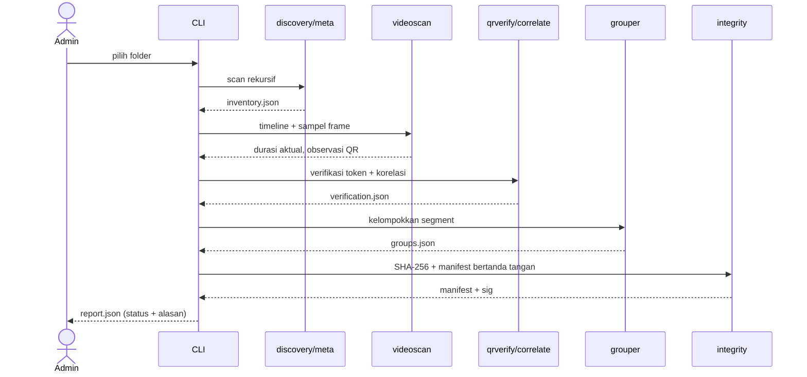
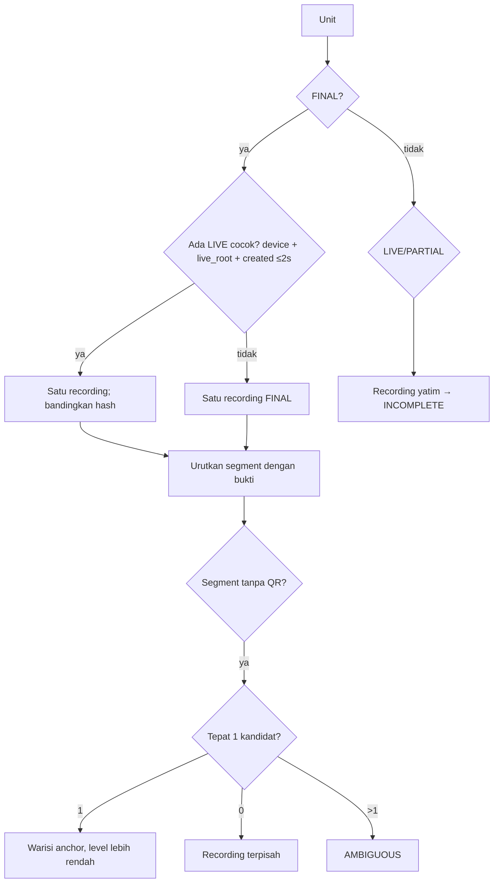

# ZYB Tool — Architecture

Status: **M1/M2 pipeline dan workspace desktop aktif; M3 local output foundation aktif dengan manifest unsigned** · 2026-11-25. Legenda: **[F]** fakta terverifikasi · **[A]** asumsi · **[?]** belum terverifikasi.
Pasangan dokumen: `PRD.md` (kebutuhan, status, aturan bisnis), `AGENTS.md`. Produk QR: `AITQR/ARCHITECTURE.md`.

## 1. Arsitektur yang direkomendasikan

**Desktop verifier offline (Python) di PC administrator**, dengan CLI dan UI desktop bertahap. Sistem keseluruhan adalah hybrid dua produk: AITQR (web/PWA, HP petugas) menerbitkan QR dan mengonfigurasi field payload; ZYB Tool (desktop) memverifikasi, mengelompokkan, menyiapkan output lokal, dan melaporkan. ZYBTool tidak terhubung ke OSS.

Dasar teknis:
- Workstation admin memiliki Python, `av` (PyAV), `cv2`, `numpy`; `cryptography` **belum** terpasang [F]. Metaqr (decoder Python) dan ZYWtool juga Python [F].
- Video 4+ GB (sampel 2: a multi-gigabyte media file [F]) harus diproses streaming dan lokal; tidak cocok dipindah ke browser.
- Kunci privat decoder hanya boleh di PC admin (aturan pemilik).
- Perangkat kamera tidak punya protokol/API yang terbukti [?]; tidak dieksplorasi pada tahap ini.

## 2. Hasil inspeksi yang menjadi dasar keputusan

### 2.1 Public fixture structure

The public fixtures demonstrate a flat finalized recording, a finalized primary recording
folder, and hidden live directories. All fixture identities, dates, clock values, camera
labels, and media measurements are synthetic.

### 2.2 Metadata contract

The parser consumes session JSON, synchronization JSON, a time-zero sidecar, camera
metadata, application logs, and optional frame-timing CSV files. Missing or conflicting
evidence lowers the result status; it is never resolved by guessing.

### 2.3 Evidence quality

- Container timeline is the primary source for video duration when media is available.
- Monotonic frame-timing values and session/synchronization claims are cross-checks.
- Application logs provide start, stop, and restart evidence.
- Camera sidecars provide crop geometry and capture-format metadata.
- Public fixtures use small synthetic values and deliberately omit video media.
### 2.4 Referensi pola nama folder (tanpa koneksi OSS)

oss://<bucket>/<approved-prefix>/
└── <project>/<site>/<date>/<operation>/
    ├── session metadata
    └── recording folders and media files

Nama folder yang pernah diamati pada penyimpanan OSS hanya dipakai sebagai referensi pola penamaan. ZYBTool tidak menyimpan kredensial OSS, tidak melakukan listing bucket, dan tidak melakukan upload/download. Field sumber dan nilai yang membentuk nama operasional dikonfigurasi di AITQR lalu dikirim melalui payload QR.
## 3. Modul dan tanggung jawab

Paket `zybtool`; semua modul inti **fungsi murni atas dataclass** (I/O dipisah) agar dapat diuji sendiri.

| Modul | Tanggung jawab | Bergantung pada |
|---|---|---|
| `discovery` | Cari kandidat folder rekursif (termasuk berawalan titik), klasifikasi `FINAL` / `LIVE` / `PARTIAL`; tidak mengikuti symlink. | — |
| `meta` | Parse JSON/log/CSV menjadi `SessionFacts`; toleran, mencatat field/file hilang. | — |
| `videoscan` | Demux timeline (PyAV), keyframe, ukuran; rentang CSV; pengambil sampel frame untuk QR (crop mata). | `meta` |
| `qrverify` | Pembungkus Metaqr: buka token, allowlist, signature, replay (source tingkat recording); validasi skema profil. | Metaqr |
| `correlate` | Cek QR ↔ session/kamera/waktu. | `meta`, `qrverify` |
| `grouper` | Segment → recording → kamera; urutan; `AMBIGUOUS`. | `meta`, `videoscan` |
| `integrity` | SHA-256 streaming, manifest, tanda tangan/verifikasi manifest. | — |
| `status` | Fungsi keputusan: bukti → status + alasan + level. | semua bukti |
| `report` | JSON kanonik; render HTML/CSV. | `status` |
| `output` | Plan lokal, copy dengan konfirmasi, pelestarian struktur, SHA-256, konflik tanpa overwrite. | `report`, `integrity` |
| `cli` | Orkestrasi dan antarmuka. | semua |

## 4. Aliran data

Setiap tahap menulis artefak JSON di `zyb_work/<run_id>/` (atomik: `.tmp` lalu rename); tahap berikutnya hanya membaca artefak. Rerun deterministik dan dapat diulang per tahap.

`inventory.json` → `groups.json` → `verification.json` → `manifest.json` + `manifest.sig` → `report.json` → `output_plan.json`.

Output preparation is local-only: the operator reviews a plan, the application copies
files without renaming original recording folders, verifies SHA-256, and records the
result. There is no OSS transfer stage.

## 5. Model data (ringkas)

| Entitas | Field kunci |
|---|---|
| `Unit` | path, kind (`FINAL`/`LIVE`/`PARTIAL`), `name_parts`, `facts`, file hilang |
| `Segment` | path mkv, ukuran, sha256, `packets`, `pts_first/last`, `csv_mono_first/last`, `restart_before` |
| `Recording` | `recording_id`, `unit_refs`, `device_id`, `segments[]` (urut), `cameras[]`, `duration_actual_s`, `anchors[]`, `status`, `reasons[]`, `level` |
| `QRObservation` | segment, frame, eye, waktu frame (wall), token_id, `kid`, hasil verifikasi |
| `Finding` | `code` (status PRD §7), `severity`, `subject`, `evidence[]`, `message` |
| `Manifest` | run_id, versi alat, hash allowlist, daftar file (path relatif, ukuran, sha256), hasil per recording, waktu, tanda tangan admin |

`recording_id` = SHA-256 dari `device_id` + `object_id` + `capture_t0.t_wall_s` [A: `object_id` unik per recording; sampel 1 dan 2 berbeda].

Contoh `Finding`: `{"code":"INCOMPLETE","subject":".live_20250210_174436","severity":"error","evidence":["no session_sync.json","no t0.json","app.log tanpa baris stop"],"message":"Folder live tidak terfinalisasi"}`.

## 6. Integrasi QR

**Sumber QR:** AITQR (profil `zyb-recording`). Kontrak: skema payload dimiliki ZYB Tool; vektor uji bersama diuji di kedua repo.

**Pemindaian:** per mkv, mulai dari `usable_start_s` (lewati frame beku), jendela default 30 s, 5 fps, **crop mata dari `meta.json`** (tanpa band IMU, tanpa pengecilan ke 1600 px seperti `scan_video` Metaqr) [A: ukuran/jendela dikalibrasi dengan kamera nyata]. Segment berikutnya dipindai dengan cara sama; tidak ada QR ≠ recording baru.

**Verifikasi (memakai Metaqr apa adanya):** buka token → allowlist (`active/retired/revoked`) → signature → replay. Replay log memakai `source = recording_id` (bukan path file), sehingga QR sama di segment berbeda pada satu recording bukan replay, tetapi di recording lain = `REPLAY_DETECTED`. Replay log dilindungi file-lock tulis tunggal [A; semantik konkurensi Metaqr ?].

**Korelasi (semua harus lolos untuk Level ≥3):**

| Cek | Aturan |
|---|---|
| C1 | `device_id` di QR = `session.json.device_id` dan identitas kamera. |
| C2 | Tanggal QR = `capture_date`. |
| C3 | `iat` QR ≤ waktu frame QR pertama (`segment_start_wall` + t frame) dan dalam toleransi konfigurabel dari `created` [A]. |
| C4 | `session_id` QR belum dipakai recording lain. |
| C5 | QR muncul di awal recording (segment pertama, jendela awal); muncul hanya di tengah/akhir → warning. |
| C6 | Payload lolos skema `zyb-recording/v1`. |

**Pemetaan keterbatasan Metaqr:**

| Keterbatasan | Penanganan di ZYB Tool |
|---|---|
| Replay | Source tingkat recording + C4. |
| Identitas device | `kid` = kunci HP, bukan kamera; ikatan ke kamera lewat `device_id` di payload + C1. |
| QR↔video | Korelasi C1–C5 + hash file + manifest (Level 4). |
| Browser | Tanggung jawab AITQR. |
| Penyimpanan kunci | Kunci privat decoder dan kunci manifest di PC admin, terlindungi DPAPI [A, pola `local encrypted credential profile`]; allowlist belum bertanda tangan (roadmap Metaqr) → hash allowlist dicatat di manifest. |

## 7. Verifikasi video dan metadata

Per segment, `videoscan` menghasilkan bukti; `status` yang menafsirkan (aturan keputusan ada di sana, bukan di scanner).

| Pemeriksaan | Cara | Hasil buruk |
|---|---|---|
| Dapat dibuka/demux | PyAV; paket PTS monoton | `CORRUPTED` |
| Durasi aktual | `pts_last − pts_first` + 1 interval frame dari timeline mkv | dasar semua perbandingan |
| Klaim vs aktual | selisih ke tiap klaim (§2.3) ≤ `max_duration_skew_s` (2,0 s [F gerbang perangkat]) | `METADATA_MISMATCH` |
| Silang CSV | rentang `mono_us` vs durasi aktual ≤ 3,0 s [A] | warning, lalu mismatch jika jauh |
| Kelengkapan | file wajib FINAL: `session.json`, `session_sync.json`, `t0.json`, `stereo/meta.json`, mkv, CSV IMU | `INCOMPLETE` |
| `session_sync.ok`/`fails` | `ok:false` atau `fails` tak kosong | warning/`INCOMPLETE` |
| Sidecar CSV | `frame_idx` maks ≈ `last_sidecar_frame`; baris ±2/3 frame itu normal [F] | tidak dipakai menghitung durasi |
| Jejak encoder | codec/encoder berbeda dari `hardware-encoder` | warning heuristik (bukan bukti) [?] |
| Pemotongan awal | QR tidak ada di segment pertama padahal ada di lain | `QR_MISSING`/mismatch |
| Mode dalam: dekode penuh | opsional, per permintaan | `CORRUPTED` bila gagal |

Mode cepat (default): demux tanpa dekode + sampel frame QR. Mode dalam: dekode seluruh frame untuk mendeteksi korupsi tengah file.

## 8. Algoritma pengelompokan segment

Prinsip: bukti temporal dan relasi metadata, bukan nama file. Tidak menebak.

**Langkah**
1. **Klasifikasi unit** dari `discovery`: `FINAL` (punya `session.json`, `session_sync.json`, `t0.json`, `stereo/meta.json`), `LIVE` (nama `.live_<YYYYMMDD>_<HHMMSS>` atau belum terfinalisasi), `PARTIAL` (sisanya yang berisi mkv). Folder datar (sampel 1) = `FINAL` tanpa nama primary.
2. **Identitas unit:** `(device_id, live_root, capture_t0.t_wall_s, object_id)`. Untuk `LIVE`, `live_root` = nama folder.
3. **Tautkan FINAL ↔ LIVE:** syarat keras semua terpenuhi: `device_id` sama, `live_root` FINAL = nama folder LIVE, `|created − created_live| ≤ 2 s`. Tertaut → satu recording; bandingkan ukuran/hash mkv (sama = salinan; beda = `AMBIGUOUS`). Tak ada tautan → LIVE berdiri sendiri (yatim) → `INCOMPLETE`. Sampel 2: dua LIVE (device `…0260`) tidak punya FINAL dan device-nya berbeda dari FINAL `…81e2` → tidak digabung.
4. **Segment dalam satu unit:** mkv per direktori kamera. Urutan dari bukti, prioritas: (a) rentang `mono_us` CSV (monoton, valid dalam satu boot); pada folder `.live_*` CSV bersifat **tingkat run** (`stereo_run_imu_frametimes.csv`, satu file untuk semua mkv [F]), pemetaan per segment [?] belum diverifikasi, (b) `segment_start_wall`/`app.log` (`RESTART`, `segment_start_number`), (c) PTS container, (d) indeks nama file sebagai petunjuk saja. Bukti saling bertentangan → `AMBIGUOUS`.
5. **Kontinuitas:** jeda antar segment dari bukti (a)/(b); jeda ≤ ambang (default 5 s [A]) = bersambung; lebih besar atau tumpang tindih = warning/`INCOMPLETE`; catat `restart_before`.
6. **Lintas unit (segment tanpa QR di unit lain):** digabung **hanya jika** tepat satu kandidat memenuhi: `device_id` sama, `live_root` atau `capture_t0` sama (atau kontinuitas monoton dalam satu boot), interval tidak tumpang tindih. Nol kandidat → recording terpisah. Lebih dari satu → `AMBIGUOUS`. Kedekatan waktu saja tidak pernah cukup.
7. **Anchor QR:** QR terverifikasi dan terkorelasi pada satu segment menjadi anchor untuk recording itu; segment lain di recording yang sama mewarisi dengan level lebih rendah bila korelasi metadata lolos; tanpa anchor sama sekali → `METADATA_ONLY`.
8. **Multi-kamera:** setiap subfolder yang punya `meta.json` dan mkv diperlakukan sebagai kamera; `wrists/gloves/bands` di `session_sync.json` dipakai bila terisi. Format selain `stereo` [?] belum pernah diamati.
9. **Keluaran stabil:** recording diurutkan `(device_id, created)`, segment menurut bukti; tidak bergantung pada urutan filesystem.

## 9. Output structure and naming reference

The original recording_primary_* folder and its contents are never renamed. Any
operational wrapper is a new parent folder.

    ZYB_Output/<OPERATION_NAME>/recording_primary_<original-name>/

Operational names are derived only from verified payload fields. Recordings without a
trusted QR are not assigned an automatic operational name. Destination conflicts stop
the operation; automatic suffixes and overwrites are forbidden.

Nama operasional mengikuti pola referensi yang ditemukan pada folder OSS, tetapi ZYBTool tidak mengakses OSS. AITQR menjadi tempat konfigurasi field yang menghasilkan komponen nama tersebut. ZYBTool hanya memverifikasi payload QR dan menyusun hasil lokal sesuai kontrak yang disepakati.
## 10. Tingkat kepercayaan dan threat model

| Level | Bukti | Membuktikan | **Tidak** membuktikan |
|---|---|---|---|
| 0 | Metadata saja | Berkas konsisten secara internal | Apa pun tentang asal; semua JSON bisa diedit |
| 1 | QR valid (terdekripsi, signature sah) | Token dibuat oleh pemegang kunci yang tercantum | Bahwa QR dibuat untuk recording ini; bisa disalin/screenshot |
| 2 | QR + `kid` ada di allowlist `active` | Kunci HP terdaftar | Orang yang memegang HP; keaslian video |
| 3 | + korelasi session/kamera (C1–C6) | QR konsisten dengan session, kamera, waktu | Video tidak diedit/diganti; kamera tidak dipalsukan |
| 4 | + integritas video + manifest bertanda tangan | Byte file yang diperiksa admin pada waktu T, terikat ke hasil verifikasi | Keaslian saat capture (kamera tidak menandatangani); admin jujur |

Tidak ada level yang membuktikan identitas orang pemegang kamera; yang dibuktikan paling jauh adalah perangkat penanda tangan QR.

| Ancaman | Mitigasi | Risiko sisa |
|---|---|---|
| QR screenshot/diputar ulang | Replay tingkat recording, C3–C5 (waktu dan posisi QR) | Replay pada recording baru oleh pemegang HP yang sah |
| Pemalsuan JSON metadata | Durasi/waktu dibandingkan dengan timeline mkv + hash | Pemalsu konsisten atas seluruh berkas dan video |
| Manipulasi timestamp | Wall vs monotonic, bukti ganda, `iat` vs frame QR | Jam kamera/HP dapat diubah [?] sumber waktu box belum diperiksa |
| Video diedit/dipotong | Hash + manifest; QR di awal; durasi vs klaim; jejak encoder | Re-encode lengkap + edit seluruh metadata |
| Durasi dipalsukan | Timeline mkv sebagai dasar | Seperti di atas |
| Device tak terdaftar | Allowlist `UNKNOWN_DEVICE` | Allowlist belum bertanda tangan (roadmap) |
| Kunci privat bocor | Decoder: rotasi + rekripsi QR baru. Device signing: `revoked` di allowlist | Token lama sebelum revoke |
| File diganti setelah verifikasi | Hash di manifest dicek ulang sebelum menyiapkan output lokal | Penggantian sebelum verifikasi |
| Segment hilang/tertukar | Urutan bukti, kontinuitas, hash, `INCOMPLETE`/`AMBIGUOUS` | Penghilangan segment akhir tanpa jejak |
| Format nama operasional tidak konsisten | Validasi field payload dan tampilkan alasan; jangan menebak nilai yang hilang | Operator memperbaiki konfigurasi AITQR |
| Akses ke shell kamera | Tidak terdeteksi (kamera tidak menandatangani) | Batas Level 4 |

## 11. Deployment dan pengujian

**Deployment:** PC admin Windows, venv Python. Python runtime tersedia [F] tetapi ketersediaan wheel `cryptography` (dibutuhkan Metaqr) untuk 3.14 [?] → pin Python yang terbukti (mis. 3.12 [A]). `av`, `cv2`, `numpy` sudah ada [F]. Pengemasan portabel mengikuti pola ZYWtool (`build_portable.ps1`, installer, CI GitHub Actions) [F ada]. Allowlist, kunci decoder, dan kunci manifest di luar repo.

**Pengujian:**
- **Unit** per modul dengan fixture JSON dari sampel (dianonimkan).
- **Golden** untuk sampel 1 dan 2 (AC-01, AC-02) — metadata saja; mkv besar hanya untuk tes integrasi lokal (`@integration`, path lewat variabel lingkungan).
- **Video sintetis kecil** (PyAV) dengan PTS dan QR yang diketahui (vektor uji Metaqr/AITQR).
- **Properti** untuk `grouper`: invarian urutan input, tidak pernah menggabung device berbeda, tidak ada hasil bergantung nama file.
- **Kegagalan:** matikan proses saat salin output lokal; ulangi → hasil identik (AC-07).
- **Kontrak** dengan AITQR (AC-11) dan CI.
- **Performa** hashing/scan file 4 GB [?] diukur di PC admin.

## 12. Perbandingan arsitektur alternatif

Skor 1–5 (5 terbaik), penilaian berdasarkan temuan di atas.

| Kriteria | Web-only | **Desktop (dipilih untuk ZYB Tool)** | Integrasi jaringan lokal | API/web perangkat | Hybrid (sistem: AITQR + ZYB) |
|---|---|---|---|---|---|
| Reliabilitas | 2 | 5 | 2 | 1 | 5 |
| Keamanan (kunci privat di PC admin) | 2 | 5 | 3 | 2 | 5 |
| Kompatibilitas HP | 4 | 1 (tidak relevan) | 2 | 2 | 5 (QR di HP) |
| Kemudahan operasional | 3 | 4 | 2 | 2 | 4 |
| Offline | 3 | 5 | 2 | 2 | 5 |
| Video besar (4 GB) | 1 | 5 | 3 | 2 | 5 |
| Maintenance | 4 | 4 | 2 | 1 | 3 |

Keputusan: sistem hybrid dua produk; ZYB Tool desktop. Integrasi jaringan/API perangkat tidak dieksplorasi (tidak ada protokol terbukti; tanpa brute force atau perubahan konfigurasi) dan hanya dipertimbangkan jika protokol terbukti tersedia.

## 13. Belum terverifikasi

- Kontinuitas PTS dan `mono_us` antar mkv di folder `.live_*` (mkv-nya belum diprobe).
- Perilaku `segment_index`, `object_id`, dan isi folder FINAL untuk recording multi-segment nyata.
- Whether other deployments use the same primary-folder layout and whether downstream consumers accept the additional folder level.
- Sumber waktu jam kamera (RTC/NTP) dan drift terhadap jam HP.
- Semantik konkurensi replay log Metaqr; kompatibilitas `cryptography` di Python 3.14.
- Keselarasan field penamaan operasional antara QR AITQR dan nama folder output.
- Format kamera selain `stereo` (wrists/gloves/bands).
- Kemampuan membaca QR dari kamera nyata pada jarak/ukuran operasional.
