# ZYB Tool — Product Requirements Document

Status: **MVP desktop berjalan** · Tanggal: 2026-11-25 · M1/M2 pipeline dan workspace UI aktif; fondasi copy lokal M3 aktif dengan penamaan operasional tetap digate sampai kontrak AITQR final. Tidak ada fitur OSS Transfers.
Repo GitHub: `progstay17/ZYBtool` (terpisah dari AITQR).

Legenda: **[F]** fakta terverifikasi dari inspeksi PC/OSS · **[A]** asumsi · **[?]** belum terverifikasi (harus diuji sebelum dipakai).
Produk ini hanya sisi **verifikasi, pengelompokan, persiapan output lokal, dan laporan**. ZYBTool tidak memiliki integrasi OSS. Pembuat QR adalah produk terpisah: **AITQR** (lihat `AITQR/PRD.md`). Detail teknis ada di `ARCHITECTURE.md`; aturan agent di `AGENTS.md`.

## 1. Problem statement

- Kamera camera system tidak menyimpan identitas petugas: blok `people` di `session.json` kosong pada semua sampel [F].
- Identitas, lokasi, dan aktivitas hanya ada di nama folder operasional yang dibuat manual. Di OSS terlihat duplikat (`… (2)`, `… (3)`), ejaan beragam, dan sufiks tidak konsisten [F].
- Satu recording bisa terpecah: `-segment_time 3600` (maks 1 jam per mkv) dan `RESTART` otomatis saat kamera error [F, `app.log`].
- Folder `.live_*` yang tidak terfinalisasi ikut terunggah sebagai folder terpisah [F].
- Belum ada cara independen untuk membuktikan bahwa recording dibuat oleh perangkat yang tercatat, atau bahwa durasinya benar.

## 2. Goals dan non-goals

**Goals**
1. Administrator memasukkan folder recording; sistem menemukan, memverifikasi, mengelompokkan, dan melaporkan secara otomatis.
2. Membaca QR MQ2 (Metaqr) yang diterbitkan AITQR dan mengikatnya ke recording yang benar.
3. Pengelompokan session/segment akurat; ambigu ditandai `AMBIGUOUS`, tidak ditebak.
4. Durasi dihitung dari bukti video/timestamp, bukan klaim metadata saja.
5. Keluaran lokal: folder induk operasional baru yang membungkus `recording_primary_*` tanpa mengubahnya. Tidak ada upload atau koneksi OSS dari ZYBTool.
6. Laporan untuk supervisor dengan status dan alasan per temuan.

**Non-goals**
- Membuat QR atau menyediakan web tool (itu AITQR).
- Membuktikan identitas orang yang memegang kamera (hanya perangkat penanda tangan yang dibuktikan).
- Mengubah firmware/konfigurasi kamera atau mengakses API perangkat (belum ada bukti protokolnya).
- Mengedit, memotong, mengonversi, atau memperbaiki video.
- Menggantikan ZYWtool (format MCAP/ZYW tidak dicakup).
- Membuat ulang kriptografi; Metaqr dipakai apa adanya.

## 3. Peran

| Peran | Tugas |
|---|---|
| Administrator | Memegang kunci privat decoder, allowlist, dan kunci tanda tangan manifest. Menjalankan verifikasi dan menyiapkan output lokal di PC. |
| Supervisor | Membaca laporan dan memutuskan tindak lanjut untuk temuan non-VERIFIED. |
| Petugas (aktor luar) | Menerbitkan QR lewat AITQR sebelum recording; tidak memakai ZYB Tool. |

## 4. Alur end-to-end

```mermaid
flowchart LR
  A[Petugas: AITQR menerbitkan QR MQ2] --> C[QR ditampilkan ke kamera, lalu recording]
  C --> D[Folder recording dikumpulkan di PC admin]
  D --> E[Discovery + parse metadata]
  E --> F[Scan QR di frame awal tiap mkv]
  F --> G[Verifikasi token + korelasi session/kamera]
  G --> H[Cek durasi aktual + integritas + hash]
  H --> I[Pengelompokan recording/segment]
  I --> J[Laporan + manifest bertanda tangan]
  J --> K[Salin ke ZYB_Output/ folder operasional]
```

## 5. Kebutuhan fungsional

| ID | Kebutuhan |
|---|---|
| FR-01 | Discovery rekursif folder recording, **termasuk folder berawalan titik** (`.live_*`). |
| FR-02 | Parse seluruh JSON (`session.json`, `session_sync.json`, `t0.json`, `stereo/meta.json`), log, CSV IMU; tandai file wajib yang hilang. |
| FR-03 | Scan beberapa frame awal setiap mkv untuk QR (kedua mata, di luar band IMU). |
| FR-04 | Verifikasi MQ2: dekripsi, allowlist, status device, signature, replay. |
| FR-05 | Validasi payload QR terhadap kontrak profil `zyb-recording` (skema dimiliki ZYB Tool, ditempatkan di AITQR sebagai konfigurasi). |
| FR-06 | Korelasi QR dengan `session.json` dan identitas kamera (device_id, waktu, session). |
| FR-07 | Hitung durasi aktual dari timeline video dan timestamp IMU/frametimes; bandingkan dengan klaim metadata. |
| FR-08 | Pengelompokan segment ke recording dan ke kamera; urutkan dengan bukti temporal. Ambigu → `AMBIGUOUS`. |
| FR-09 | Hash SHA-256 semua file dan manifest verifikasi bertanda tangan. |
| FR-10 | Susun keluaran lokal `ZYB_Output/<operasional>/recording_primary_*/…` (salin, bukan pindah, secara default). |
| FR-11 | Memvalidasi field payload QR yang dipakai AITQR untuk membentuk pola nama folder operasional. |
| FR-12 | Laporan per recording dan total (lihat §7) dalam JSON kanonik + tampilan yang bisa dibaca supervisor. |

## 6. Kebutuhan non-fungsional

- **Keamanan:** kunci privat decoder hanya di PC administrator; tidak ada kredensial OSS di ZYBTool; aplikasi sepenuhnya lokal/offline.
- **Keamanan data input:** input hanya dibaca (read-only); tidak ada perubahan pada folder sumber.
- **Performa:** file 4+ GB; hashing/scan streaming, tidak memuat seluruh file ke memori. Target throughput [?] diukur pada PC admin.
- **Reliabilitas:** setiap tahap dapat diulang tanpa efek samping; hasil deterministik untuk input yang sama.
- **Offline:** verifikasi dan laporan berjalan sepenuhnya lokal/offline.
- **Maintainability:** modul independen yang dapat diuji terpisah (`ARCHITECTURE.md` §3).
- **Privasi:** nama petugas muncul di metadata/laporan; laporan dan log tidak menyertakan kunci/secret.

## 7. Laporan dan status

Isi laporan: recorder, device, lokasi/aktivitas, tanggal/waktu, jumlah recording, jumlah segment, durasi per recording dan total, status QR/signature, status metadata, status integritas, status pengurutan, kecocokan field penamaan, warning/rejection beserta alasan.

| Status | Makna |
|---|---|
| `VERIFIED` | QR valid + device trusted + korelasi session/kamera lolos + integritas video lolos + manifest bertanda tangan (Level 4). |
| `VERIFIED_WITH_WARNING` | Seperti di atas, dengan warning non-kritis (mis. `iat` di tepi toleransi, retired key). |
| `METADATA_ONLY` | Tidak ada QR; hanya metadata yang bisa diedit (Level 0). Tidak pernah menjadi `VERIFIED`. |
| `QR_MISSING` | Segment/file tanpa QR sementara recording lain punya anchor tetapi korelasi tidak cukup. |
| `INVALID_SIGNATURE` | Dekripsi/signature gagal. |
| `UNKNOWN_DEVICE` | `kid` tidak ada di allowlist, atau status `revoked`. |
| `REPLAY_DETECTED` | Token sama muncul di recording berbeda. |
| `METADATA_MISMATCH` | QR/metadata/durasi tidak konsisten satu sama lain. |
| `INCOMPLETE` | File/segment wajib hilang, folder `.live_*` tak terfinalisasi, atau log berhenti tanpa `stop`. |
| `AMBIGUOUS` | Lebih dari satu kandidat pengelompokan yang sama kuat. |
| `CORRUPTED` | File tidak bisa dibaca/di-demux atau hash tidak cocok. |

Tingkat kepercayaan (Level 0–4) dan batas pembuktiannya ada di `ARCHITECTURE.md` §10.

## 8. Aturan bisnis

- **BR-01 (kritis):** nama folder `recording_primary_*` dan seluruh isinya **tidak pernah di-rename**. Nama operasional hanya diterapkan pada folder induk baru.
- **BR-02:** struktur keluaran: `ZYB_Output/<NAMA_OPERASIONAL>/recording_primary_*/…`. Ini keputusan pemilik produk (2026-11-25). Catatan [F]: di contoh destination storage, isi primary berada langsung di folder operasional tanpa level `recording_primary_*`; kompatibilitas sistem hilir terhadap struktur output baru **[?] harus dikonfirmasi** sebelum dipakai operasional.
- **BR-03:** nama operasional mengikuti pola yang ditemukan di OSS (`yyyymmdd_MM<kode>_<Recorder>_ZY<nnn>_S<n>_<Aktivitas>`, `ARCHITECTURE.md` §9); komponen berasal dari QR yang terverifikasi, bukan dari metadata yang bisa diedit. Recording tanpa QR terverifikasi tidak diberi nama operasional otomatis; ditempatkan di `ZYB_Output/_UNNAMED/` untuk keputusan operator.
- **BR-04:** QR valid tidak otomatis membuktikan recording asli; harus dikorelasikan dengan kamera, waktu, segment, dan hash.
- **BR-05:** segment tanpa QR tidak otomatis recording baru; dicocokkan lewat metadata. Kandidat ganda → `AMBIGUOUS`.
- **BR-06:** recording dari device/session berbeda tidak digabung hanya karena waktunya berdekatan.
- **BR-07:** tidak ada status `VERIFIED` dari metadata saja.
- **BR-08:** tidak ada auto-suffix ` (2)`; bentrokan nama → berhenti dan minta keputusan operator.
- **BR-09:** ZYBTool tidak melakukan koneksi ke OSS, tidak membaca bucket, dan tidak mengunggah/mengunduh objek. Pola nama folder yang pernah diamati hanya menjadi referensi format untuk kontrak AITQR.
- **BR-10:** folder `.live_*` tak terfinalisasi tidak otomatis dimasukkan ke output operasional.

## 9. Kriteria penerimaan

| ID | Kriteria (uji pada sampel nyata bila disebut) |
|---|---|
| AC-01 | Sampel 1 (`sample1_flat fixture`): 1 recording, 1 segment, synthetic device identifier, durasi sintetis yang konsisten dengan fixture, status `METADATA_ONLY`. |
| AC-02 | Sampel 2: primary `the finalized primary fixture` = 1 recording, 1 segment, synthetic duration. Dua folder `.live_*` (separate synthetic live-device identifier) **tidak** digabung ke `synthetic finalized fixture` dan dilaporkan `INCOMPLETE` dengan alasan. |
| AC-03 | Tanpa QR, tidak ada hasil `VERIFIED` pada kondisi apa pun. |
| AC-04 | Token yang sama pada dua segment satu recording → bukan replay; pada dua recording berbeda → `REPLAY_DETECTED`. |
| AC-05 | `session.json` diubah (durasi/waktu) → `METADATA_MISMATCH` atau `CORRUPTED`, bukan `VERIFIED`. |
| AC-06 | Keluaran lokal: nama folder primary dan hash SHA-256 setiap file identik dengan sumber; sumber tidak berubah. |
| AC-07 | Menjalankan ulang pipeline dan persiapan output menghasilkan keluaran identik, tanpa duplikat atau sufiks `(n)`. |
| AC-08 | Penyalinan lokal dihentikan lalu diulang: sumber tidak berubah dan hasil diverifikasi ulang. |
| AC-09 | Laporan memuat semua field §7 dan alasan tiap warning/rejection. |
| AC-10 | Satu folder berisi recording dari 2 device → 2 recording terpisah. |
| AC-11 | QR dari AITQR (vektor uji bersama) terbaca dan lolos verifikasi pada video uji sintetis. |

## 10. Edge case dan penanganan kegagalan

| Kasus | Penanganan |
|---|---|
| Segment kedua tanpa QR | Cocokkan via `device_id`, `live_root`, `capture_t0`, waktu; tunggal → gabung (Level ≤3); ganda → `AMBIGUOUS`. |
| Restart kamera, pindah `/dev/video0`→`/dev/video1` | Dicatat dari `app.log`; urutan dari bukti temporal, bukan nama file. |
| `.live_*` tanpa `session_sync/t0/meta`, log tanpa `stop` | `INCOMPLETE`; tidak diunggah default. |
| Sidecar IMU hanya ±2/3 frame (band diambil 20 fps dari 30 fps) [F] | Jumlah baris CSV tidak dipakai menghitung durasi/frame. |
| PTS container sintetis [F] | Durasi diverifikasi silang dengan `mono_us`/`exp_start_us`. |
| `nb_frames = 0` di `session_sync.json` [F] | Diabaikan sebagai bukti. |
| QR terbaca tapi bukan milik recording (rekam ulang/screenshot) | Korelasi waktu/device gagal → `METADATA_MISMATCH`/`REPLAY_DETECTED`. |
| Jam HP vs jam kamera berbeda | `iat` hanya klaim; toleransi konfigurabel, di luar toleransi → warning/mismatch. |
| Kunci device hilang (diatur AITQR) | Device baru + entri allowlist baru; token lama valid selama entri lama aktif. |
| File berubah setelah verifikasi | Hash manifest tidak cocok → `CORRUPTED`; wajib verifikasi ulang. |
| Disk penuh / koneksi putus | Tulis atomik (`.tmp` lalu rename), penyalinan dapat diulang tanpa mengubah sumber. |
| Nama operasional bentrok | Berhenti, minta keputusan operator; tidak ada auto-suffix. |

## 11. MVP dan roadmap

Rekaman saat ini **belum memuat QR** (konfirmasi pemilik), jadi urutan dimulai dari yang sudah bisa bekerja:

| Tahap | Isi | Keluaran |
|---|---|---|
| M1 | Discovery, parser metadata, scanner video (timeline/durasi), grouper, laporan. Tanpa QR → `METADATA_ONLY`. | Laporan atas sampel nyata. |
| M2 | Scanner QR + verifikasi MQ2 (vektor uji Metaqr/AITQR) + korelasi + manifest bertanda tangan. | Level 3–4. |
| M3 | Penyusun folder keluaran (salin + verifikasi hash). | `ZYB_Output/`. |
| Roadmap | Allowlist bertanda tangan, rotasi kunci decoder, antarmuka supervisor, integrasi API perangkat (bila protokol terbukti). | — |

Ketergantungan: M2 butuh rilis awal AITQR (atau vektor uji sintetis) untuk QR nyata.

## 12. Keputusan terbuka

| ID | Pertanyaan | Catatan |
|---|---|---|
| D1 | Compatibility of downstream consumers with the additional primary-recording folder level. | [?] Must be validated in a non-production environment. |
| D2 | Sumber kode `MM<kode>` dan nomor `ZY<nnn>`. | Tidak ada di `session.json`; harus masuk payload QR (profil AITQR). |
| D3 | Template/normalisasi nama operasional (location suffix, ejaan, panjang nama). | Variasi nyata di OSS. |
| D4 | Salin vs pindah ke `ZYB_Output`. | Default: salin. |
| D5 | Toleransi selisih `iat` terhadap waktu kamera. | Konfigurabel. |
| D6 | Kontrak akhir pemetaan field AITQR ke nama folder operasional. | Dikonfigurasi pada AITQR, bukan melalui koneksi OSS dari ZYBTool. |
| D7 | Nama repo GitHub. | Usulan `ZYBTool`. |
