# ZYB Tool — Product Requirements Document

Status: **MVP desktop berjalan** · Tanggal: 2026-11-25 · M1/M2 pipeline dan workspace UI aktif; Arrange MOVE + Excel Export aktif; Naming Convention GUI dengan JSON scanner dan No Shift. Nama folder default memakai tanggal capture native dan field payload MQ1 terverifikasi; Preferences dapat memetakan field JSON dan mengubah template tanpa melemahkan verifikasi QR. Tidak ada fitur OSS Transfers.
Repo GitHub: `progstay17/ZYBtool` (terpisah dari AITQR).

Legenda: **[F]** fakta terverifikasi dari inspeksi PC/OSS · **[A]** asumsi · **[?]** belum terverifikasi (harus diuji sebelum dipakai).
Produk ini hanya sisi **verifikasi, pengelompokan, persiapan output lokal, dan laporan**. ZYBTool tidak memiliki integrasi OSS. Pembuat QR adalah produk terpisah: **AITQR** (lihat `AITQR/PRD.md`). Detail teknis ada di `ARCHITECTURE.md`; aturan agent di `AGENTS.md`.

## 1. Problem statement

- Kamera camera system tidak menyimpan identitas petugas: blok `people` di `session.json` kosong pada semua sampel [F].
- Identitas, lokasi, dan aktivitas hanya ada di nama folder operasional yang dibuat manual. Di OSS terlihat duplikat (`… (2)`, `… (3)`), ejaan beragam, dan sufiks tidak konsisten [F].
- Satu recording bisa terpecah: `-segment_time 3600` (maks 1 jam per mkv) dan `RESTART` otomatis saat kamera error [F, `app.log`].
- Folder `.live_*` yang tidak terfinalisasi ikut terunggah sebagai folder terpisah [F].
- Belum ada cara independen untuk membuktikan bahwa recording dibuat oleh perangkat yang tercatat, atau bahwa durasinya benar.

## 2. Goals dan non-goals

**Goals**
1. Administrator memasukkan folder recording; sistem menemukan, memverifikasi, mengelompokkan, dan melaporkan secara otomatis.
2. Membaca QR terenkripsi MQ1 (Metaqr) yang diterbitkan AITQR dan mengikat payload ke metadata recording.
3. Pengelompokan session/segment akurat; ambigu ditandai `AMBIGUOUS`, tidak ditebak.
4. Durasi dihitung dari bukti video/timestamp, bukan klaim metadata saja.
5. Keluaran lokal: folder induk operasional baru yang membungkus `recording_primary_*` tanpa mengubahnya. Tidak ada upload atau koneksi OSS dari ZYBTool.
6. Laporan untuk supervisor dengan status dan alasan per temuan.

**Non-goals**
- Membuat QR atau menyediakan web tool (itu AITQR).
- Membuktikan identitas orang yang memegang kamera (hanya perangkat penanda tangan yang dibuktikan).
- Mengubah firmware/konfigurasi kamera atau mengakses API perangkat (belum ada bukti protokolnya).
- Mengedit, memotong, mengonversi, atau memperbaiki video.
- Menggantikan ZYWtool (format MCAP/ZYW tidak dicakup).
- Membuat ulang kriptografi; Metaqr dipakai apa adanya.

## 3. Peran

| Peran | Tugas |
|---|---|
| Administrator | Memegang kunci privat decoder dan kunci tanda tangan manifest (jika kelak diaktifkan). Tidak ada allow-list (tidak digunakan pada MQ1). Menjalankan verifikasi dan menyiapkan output lokal di PC. |
| Supervisor | Membaca laporan dan memutuskan tindak lanjut untuk temuan non-QR_DECRYPTED. |
| Petugas (aktor luar) | Menerbitkan QR lewat AITQR sebelum recording; tidak memakai ZYB Tool. |

## 4. Alur end-to-end

```mermaid
flowchart LR
  A[Petugas: AITQR menerbitkan QR MQ1 terenkripsi] --> C[QR ditampilkan ke kamera, lalu recording]
  C --> D[Folder recording dikumpulkan di PC admin]
  D --> E[Discovery + parse metadata]
  E --> F[Scan QR di frame awal tiap mkv]
  F --> G[Verifikasi token + korelasi session/kamera]
  G --> H[Cek durasi aktual + integritas + hash]
  H --> I[Pengelompokan recording/segment]
  I --> J[Laporan + manifest bertanda tangan]
  J --> K[Move ke ZYB_Output/ folder operasional]
```

## 5. Kebutuhan fungsional

| ID | Kebutuhan |
|---|---|
| FR-01 | Discovery rekursif folder recording, **termasuk folder berawalan titik** (`.live_*`). |
| FR-02 | Parse seluruh JSON (`session.json`, `session_sync.json`, `t0.json`, `stereo/meta.json`), log, CSV IMU; tandai file wajib yang hilang. |
| FR-03 | Scan beberapa frame awal setiap mkv untuk QR (kedua mata, di luar band IMU). |
| FR-04 | Dekripsi MQ1 dengan private key decoder, validasi skema payload, dan korelasi device ID ke session. Tidak ada signature/allow-list (tidak digunakan pada MQ1)/replay. |
| FR-05 | Validasi payload QR terhadap kontrak profil `zyb-recording` (skema dimiliki ZYB Tool, ditempatkan di AITQR sebagai konfigurasi). |
| FR-06 | Korelasi QR dengan `session.json` dan identitas kamera (device_id, waktu, session). |
| FR-07 | Hitung durasi aktual dari timeline video dan timestamp IMU/frametimes; bandingkan dengan klaim metadata. |
| FR-08 | Pengelompokan segment ke recording dan ke kamera; urutkan dengan bukti temporal. Ambigu → `AMBIGUOUS`. |
| FR-09 | Hash SHA-256 semua file dan manifest verifikasi bertanda tangan. |
| FR-10 | Arrange ke `ZYB_Output/<operasional>/recording_primary_*/…` dengan MOVE setelah preview dan konfirmasi; jurnal Undo wajib. |
| FR-11 | Setelah QR MQ1 berhasil didekripsi dan device ID cocok, tambahkan metadata QR pada `session.json` di lokasi output setelah MOVE; pertahankan seluruh field native. |
| FR-12 | Laporan per recording dan total (lihat §7) dalam JSON kanonik + tampilan yang bisa dibaca supervisor. |
| FR-13 | Excel Export dengan sheet `ZY White`, `Cek File`, `Scan Audit`, `Rekonsiliasi`; `ZY White` dikelompokkan menurut device, tanggal, aktivitas, lokasi, `ss` QR, dan recorder. Shift wajib mengikuti payload `ss` (tanpa inferensi timestamp/pembagian durasi lintas shift); jumlah sesi, durasi, dan ukuran data dihitung sekali per recording. Durasi ditampilkan sebagai `[h]:mm:ss` dan total data mencakup semua file pada folder unit recording (bukan hanya MKV), ditampilkan ringkas dalam GB dua desimal. Perhitungan ukuran memakai metadata filesystem tanpa membaca isi file. Tidak ada kolom Qualified/Rejected. Pertahankan kolom QC manual dan buat backup saat export ulang. Arrange MOVE tidak berubah. |
| FR-14 | Preferences menyediakan JSON Variable Scanner, browse file JSON contoh, deteksi nested object/array, mapping field ke token folder, template editor, dan live preview. |
| FR-15 | Mode No Shift menghilangkan token SESSION dari nama folder sepenuhnya; tidak boleh menghasilkan `S0` atau separator ganda. |

## 6. Kebutuhan non-fungsional

- **Keamanan:** kunci privat decoder hanya di PC administrator; tidak ada kredensial OSS di ZYBTool; aplikasi sepenuhnya lokal/offline.
- **Keamanan data input:** scan read-only. Arrange MOVE hanya berjalan setelah preview + persetujuan eksplisit, dengan hash, jurnal dan Undo.
- **Performa:** file 4+ GB; hashing/scan streaming, tidak memuat seluruh file ke memori. Target throughput [?] diukur pada PC admin.
- **Reliabilitas:** setiap tahap dapat diulang tanpa efek samping; hasil deterministik untuk input yang sama.
- **Offline:** verifikasi dan laporan berjalan sepenuhnya lokal/offline.
- **Maintainability:** modul independen yang dapat diuji terpisah (`ARCHITECTURE.md` §3).
- **Privasi:** nama petugas muncul di metadata/laporan; laporan dan log tidak menyertakan kunci/secret.

## 7. Laporan dan status

Isi laporan: recorder, device, lokasi/aktivitas, tanggal/waktu, jumlah recording, jumlah segment, durasi per recording dan total, status dekripsi QR, status metadata, status integritas, status pengurutan, kecocokan field penamaan, warning/rejection beserta alasan.

| Status | Makna |
|---|---|
| `QR_DECRYPTED` | QR MQ1 berhasil didekripsi dan payload lolos validasi dasar serta kecocokan device ID. Pengirim tidak diautentikasi (Level 1). |
| `QR_DECRYPT_FAILED` | QR MQ1 ditemukan tetapi private key tidak tersedia atau dekripsi gagal. |
| `METADATA_ONLY` | Tidak ada QR yang terdeteksi; hanya metadata kamera yang tersedia (Level 0). |
| `QR_MISSING` | Segment/file tanpa QR sementara recording lain punya anchor tetapi korelasi tidak cukup. |
| `METADATA_MISMATCH` | Payload tidak cocok dengan metadata native recording. |
| `QR_MISSING` | Tidak ada token QR pada jendela scan. |
| `REPLAY_DETECTED` | Token sama muncul di recording berbeda. |
| `METADATA_MISMATCH` | QR/metadata/durasi tidak konsisten satu sama lain. |
| `INCOMPLETE` | File/segment wajib hilang, folder `.live_*` tak terfinalisasi, atau log berhenti tanpa `stop`. |
| `AMBIGUOUS` | Lebih dari satu kandidat pengelompokan yang sama kuat. |
| `CORRUPTED` | File tidak bisa dibaca/di-demux atau hash tidak cocok. |

Tingkat kepercayaan (Level 0–4) dan batas pembuktiannya ada di `ARCHITECTURE.md` §10.

## 8. Aturan bisnis

- **BR-01 (kritis):** nama folder `recording_primary_*` dan seluruh isinya **tidak pernah di-rename**. Nama operasional hanya diterapkan pada folder induk baru.
- **BR-02:** struktur keluaran: `ZYB_Output/<NAMA_OPERASIONAL>/recording_primary_*/…`. Ini keputusan pemilik produk (2026-11-25). Catatan [F]: di contoh destination storage, isi primary berada langsung di folder operasional tanpa level `recording_primary_*`; kompatibilitas sistem hilir terhadap struktur output baru **[?] harus dikonfirmasi** sebelum dipakai operasional.
- **BR-03:** session.json kamera adalah dokumen utama. QR MQ1 yang berhasil didekripsi dan lolos korelasi device ID hanya melengkapi session.json di folder output setelah MOVE; seluruh metadata native dipertahankan. Metadata QR tidak boleh mengganti device_id, waktu capture, atau field native lain. Nama folder pembungkus output mengikuti pola operasional dari payload MQ1 yang telah didekripsi.
- **BR-04:** QR valid tidak otomatis membuktikan recording asli; harus dikorelasikan dengan kamera, waktu, segment, dan hash.
- **BR-05:** segment tanpa QR tidak otomatis recording baru; dicocokkan lewat metadata. Kandidat ganda → `AMBIGUOUS`.
- **BR-06:** recording dari device/session berbeda tidak digabung hanya karena waktunya berdekatan.
- **BR-07:** tidak ada status `QR_DECRYPTED` dari metadata saja.
- **BR-08:** tidak ada auto-suffix ` (2)`; bentrokan nama → berhenti dan minta keputusan operator.
- **BR-09:** ZYBTool tidak melakukan koneksi ke OSS, tidak membaca bucket, dan tidak mengunggah/mengunduh objek. Pola nama folder yang pernah diamati hanya menjadi referensi format untuk kontrak AITQR.
- **BR-10:** folder `.live_*` tak terfinalisasi tidak otomatis dimasukkan ke output operasional.
- **BR-11:** template dan mapping hanya mengubah nama folder induk output; tidak mengubah payload QR, hasil verifikasi, metadata native, atau nama recording/subfolder. Mapping dibaca dari JSON sumber dan payload QR yang telah lolos verifikasi.
- **BR-12:** No Shift menghapus token SESSION dari hasil render. Nilai kosong/0 tidak boleh ditampilkan sebagai `S0`.

## 9. Kriteria penerimaan

| ID | Kriteria (uji pada sampel nyata bila disebut) |
|---|---|
| AC-01 | Sampel 1 (`sample1_flat fixture`): 1 recording, 1 segment, synthetic device identifier, durasi sintetis yang konsisten dengan fixture, status `METADATA_ONLY`. |
| AC-02 | Sampel 2: primary `the finalized primary fixture` = 1 recording, 1 segment, synthetic duration. Dua folder `.live_*` (separate synthetic live-device identifier) **tidak** digabung ke `synthetic finalized fixture` dan dilaporkan `INCOMPLETE` dengan alasan. |
| AC-03 | Tanpa QR terdekripsi, tidak ada hasil `QR_DECRYPTED` pada kondisi apa pun. |
| AC-04 | Token yang sama pada dua segment satu recording → bukan replay; pada dua recording berbeda → `REPLAY_DETECTED`. |
| AC-05 | `session.json` diubah (durasi/waktu) → `METADATA_MISMATCH` atau `CORRUPTED`, bukan `QR_DECRYPTED`. |
| AC-06 | Keluaran MOVE mempertahankan nama folder primary, hierarki, dan hash SHA-256 seluruh file; jurnal mencatat asal/tujuan. |
| AC-07 | Menjalankan ulang pipeline dan persiapan output menghasilkan keluaran identik, tanpa duplikat atau sufiks `(n)`. |
| AC-08 | MOVE gagal di tengah: semua perpindahan yang sudah selesai di-rollback; Undo menolak bentrok dan mengembalikan sumber. |
| AC-09 | Laporan memuat semua field §7 dan alasan tiap warning/rejection. |
| AC-10 | Satu folder berisi recording dari 2 device → 2 recording terpisah. |
| AC-11 | QR dari AITQR (vektor uji bersama) terbaca dan lolos verifikasi pada video uji sintetis. |

## 10. Edge case dan penanganan kegagalan

| Kasus | Penanganan |
|---|---|
| Segment kedua tanpa QR | Cocokkan via `device_id`, `live_root`, `capture_t0`, waktu; tunggal → gabung (Level ≤3); ganda → `AMBIGUOUS`. |
| Restart kamera, pindah `/dev/video0`→`/dev/video1` | Dicatat dari `app.log`; urutan dari bukti temporal, bukan nama file. |
| `.live_*` tanpa `session_sync/t0/meta`, log tanpa `stop` | `INCOMPLETE`; tidak diunggah default. |
| Sidecar IMU hanya ±2/3 frame (band diambil 20 fps dari 30 fps) [F] | Jumlah baris CSV tidak dipakai menghitung durasi/frame. |
| PTS container sintetis [F] | Durasi diverifikasi silang dengan `mono_us`/`exp_start_us`. |
| `nb_frames = 0` di `session_sync.json` [F] | Diabaikan sebagai bukti. |
| QR terbaca tapi bukan milik recording (rekam ulang/screenshot) | Korelasi waktu/device gagal → `METADATA_MISMATCH`/`REPLAY_DETECTED`. |
| Jam HP vs jam kamera berbeda | `iat` hanya klaim; toleransi konfigurabel, di luar toleransi → warning/mismatch. |
| Private key decoder hilang | QR lama tidak dapat didekripsi; pulihkan private key dari backup aman. |
| File berubah setelah verifikasi | Hash manifest tidak cocok → `CORRUPTED`; wajib verifikasi ulang. |
| Disk penuh / koneksi putus | Tulis atomik (`.tmp` lalu rename), penyalinan dapat diulang tanpa mengubah sumber. |
| Nama operasional bentrok | Berhenti, minta keputusan operator; tidak ada auto-suffix. |

## 11. MVP dan roadmap

Rekaman saat ini **belum memuat QR** (konfirmasi pemilik), jadi urutan dimulai dari yang sudah bisa bekerja:

| Tahap | Isi | Keluaran |
|---|---|---|
| M1 | Discovery, parser metadata, scanner video (timeline/durasi), grouper, laporan. Tanpa QR → `METADATA_ONLY`. | Laporan atas sampel nyata. |
| M2 | Scanner QR + dekripsi MQ1 + validasi envelope + pemeriksaan recording. | VERIFIED jika seluruh pemeriksaan lolos; MQ1 hanya mengenkripsi. |
| M3 | Arrange MOVE + Undo journal, Excel Export ala ZYWTool. | `ZYB_Output/` + workbook. |
| Roadmap | Rotasi kunci decoder, antarmuka supervisor, manifest bertanda tangan, integrasi API perangkat (bila diperlukan). | — |

Ketergantungan: M2 butuh rilis awal AITQR (atau vektor uji sintetis) untuk QR nyata.

## 12. Keputusan terbuka

| ID | Pertanyaan | Catatan |
|---|---|---|
| D1 | Compatibility of downstream consumers with the additional primary-recording folder level. | [?] Must be validated in a non-production environment. |
| D2 | Metadata AITQR yang belum ada di session.json kamera. | Disimpan sebagai pelengkap pada zybtool.qr_metadata, tanpa menimpa field native. |
| D3 | Template/normalisasi nama operasional (location suffix, ejaan, panjang nama). | Variasi nyata di OSS. |
| D4 | Salin vs pindah ke `ZYB_Output`. | Diputuskan: MOVE dengan jurnal dan Undo. |
| D5 | Toleransi selisih `iat` terhadap waktu kamera. | Konfigurabel. |
| D6 | Kontrak akhir pemetaan field QR ke metadata pelengkap session.json. | Disepakati bersama AITQR; QR hanya melengkapi dokumen native. |
| D7 | Nama repo GitHub. | Usulan `ZYBTool`. |

## Keputusan protokol 2026-11-25

ZYBTool dan AITQR memakai Metaqr MQ1 encrypted-only. AITQR tidak membuat keypair Ed25519 per petugas, tidak menerbitkan allow-list, dan tidak menandatangani QR. ZYBTool hanya membutuhkan private key X25519 untuk mendekripsi. `QR_DECRYPTED` tidak menyatakan identitas pembuat QR; public key yang tersebar memungkinkan siapa pun membuat token terenkripsi. Tanda tangan Ed25519 tetap dipakai hanya untuk integritas bundle konfigurasi admin AITQR, bukan QR operasional.
